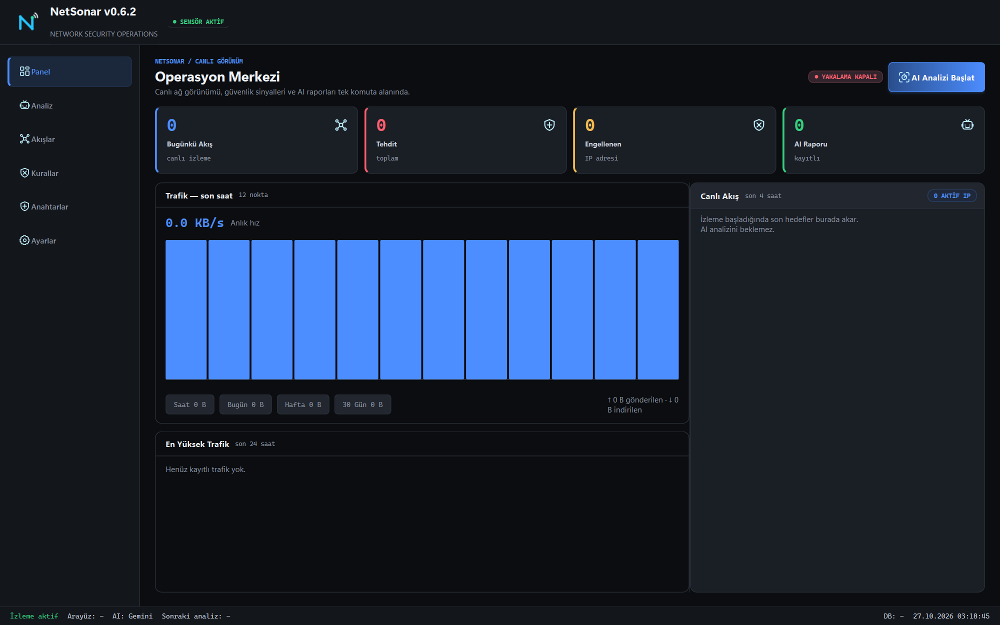
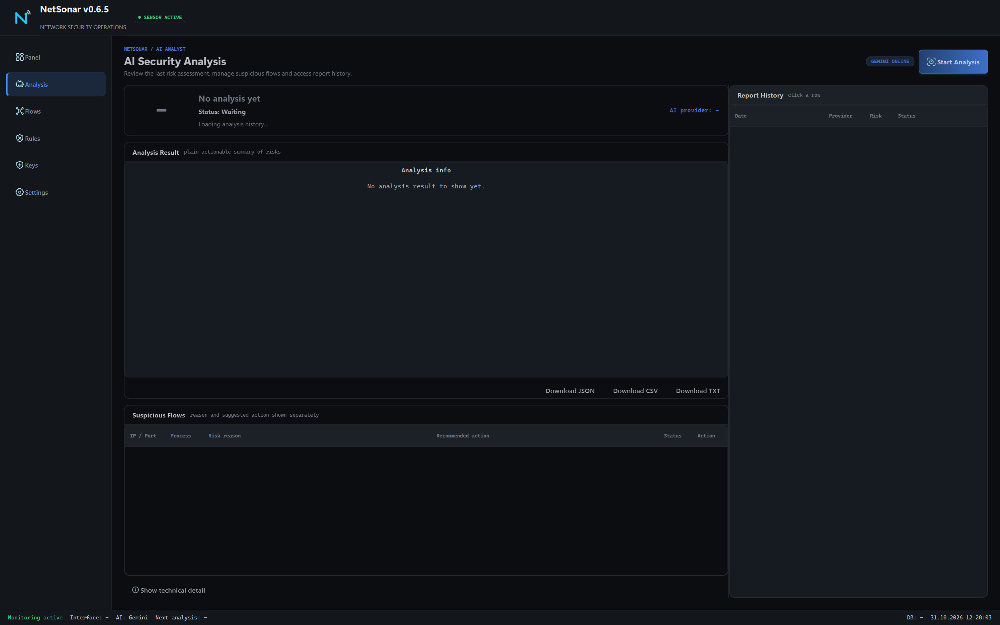
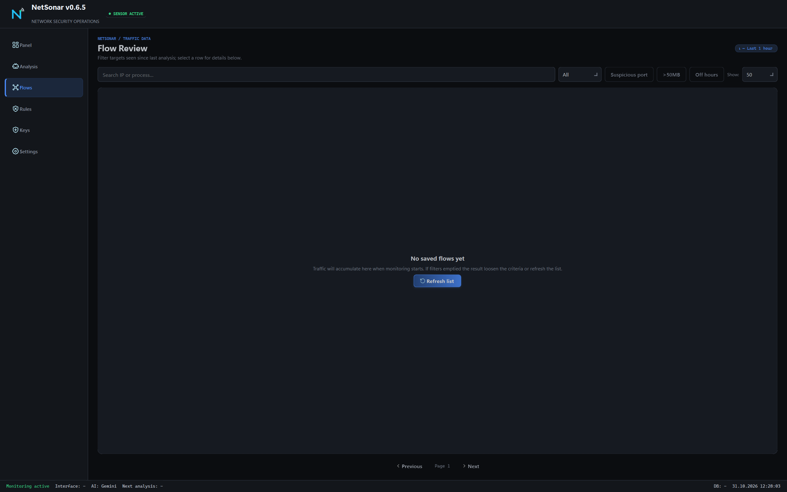
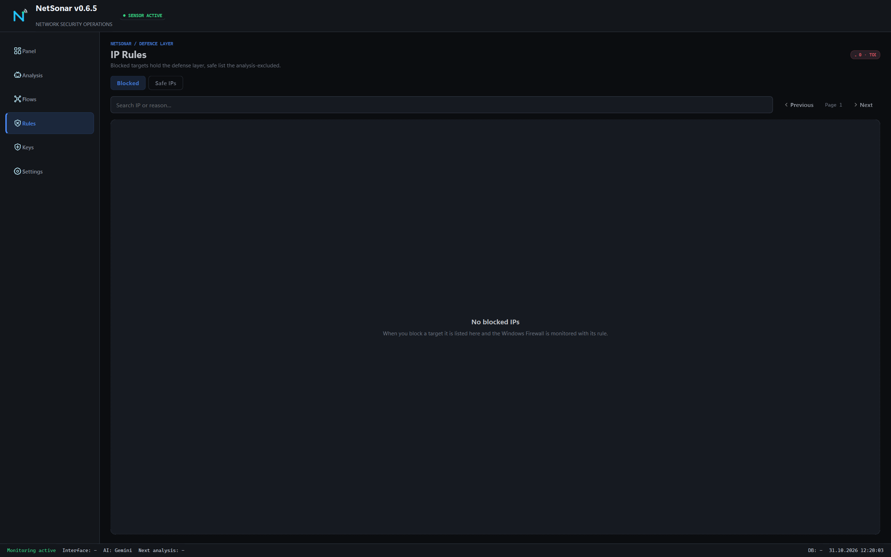
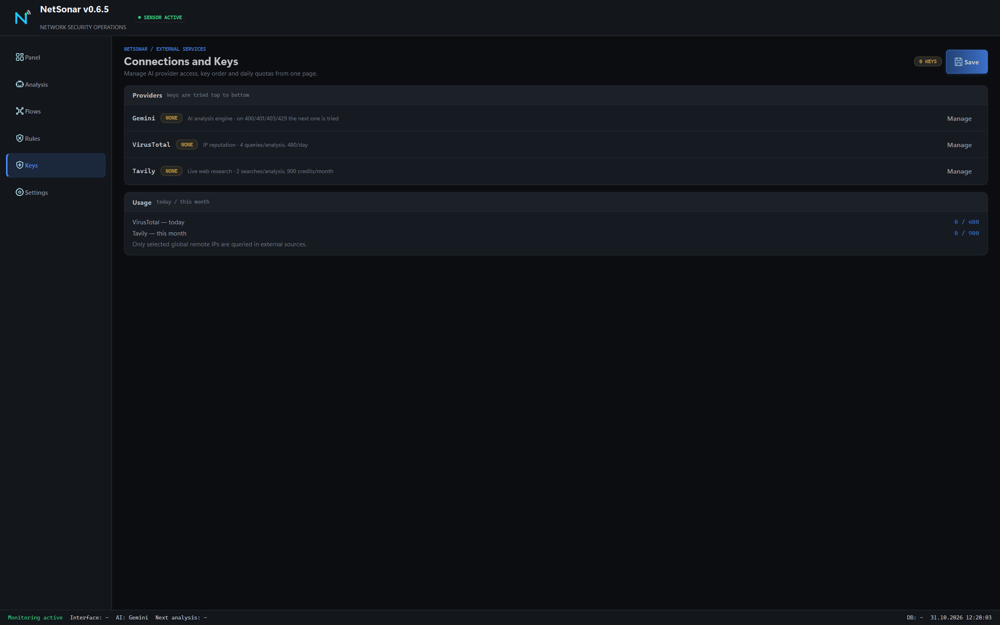
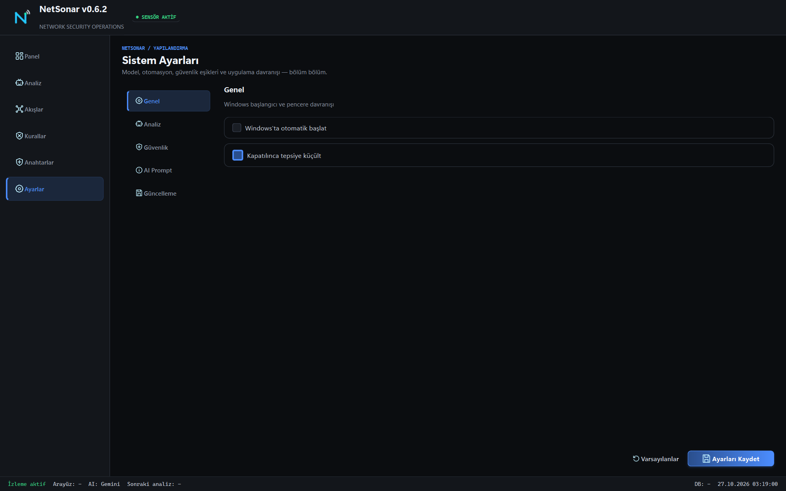

# NetSonar — AI-assisted network visibility for Windows

> Turkish: [README.tr.md](./README.tr.md)

**See what your machine is talking to, and let an AI tell you if it is a problem.**

NetSonar captures local network traffic through Npcap, summarises it into per-minute bidirectional flows, maps every flow to the process that opened it, and sends the summary to Gemini for a risk assessment backed by VirusTotal reputation and web context. When you decide something must be blocked, it writes an audited Windows Firewall rule.

Raw payload is discarded by design — no content, no URLs, no passwords are logged.



---

## Contents

- [What it does](#what-it-does)
- [Screens, one by one](#screens-one-by-one)
  - [1. Panel](#1-panel)
  - [2. Analysis](#2-analysis)
  - [3. Flows](#3-flows)
  - [4. Rules](#4-rules)
  - [5. Keys](#5-keys)
  - [6. Settings](#6-settings)
- [Requirements](#requirements)
- [Install](#install)
- [Command line](#command-line)
- [How analysis works](#how-analysis-works)
- [Privacy and retention](#privacy-and-retention)
- [Project structure](#project-structure)
- [License](#license)

---

## What it does

| Capability | Detail |
|---|---|
| **Live capture** | Npcap + scapy, summarised into per-minute bidirectional flow buckets |
| **Process mapping** | per-process, endpoint, port and protocol counters with sent/received split |
| **AI analysis** | batched structured Gemini analysis; invented IPs, sources and flow IDs rejected by local verification |
| **Threat intel** | VirusTotal reputation plus web context for selected public remote IPs only |
| **Key failover** | multiple API keys with automatic failover, DPAPI-encrypted at rest |
| **Firewall blocking** | audited bidirectional rules in a dedicated `NetSonar` group; off by default |
| **SOC panel** | live flow table, metric cards, report view, tray icon |
| **Scheduler** | timed analysis and database maintenance with desktop notifications |
| **Reports** | JSON, CSV and TXT export |
| **Retention** | raw detail dropped, IP-less hourly totals kept 30 days, unanalysed detail anonymised within 24 hours |

---

## Screens, one by one

The captures below come from a clean install with no data, so the counters read zero — that is what a first launch looks like.

### 1. Panel


The operational centre. Four cards across the top:

| Card | Meaning |
|---|---|
| **Today's Flows** | flows captured today, updated live |
| **Threats** | total threats the AI has flagged |
| **Blocked** | IPs currently blocked by firewall rule |
| **AI Reports** | number of stored analysis reports |

Under the cards sits the **traffic chart** with hour / day / week / 30-day totals and the sent-versus-received split, plus a **top traffic** panel. On the right, **Live Flows** streams the newest destinations as they are captured, without waiting for an analysis.

The header shows sensor state (`SENSOR ACTIVE`), capture state (`CAPTURE OFF` / on), and the `Start AI Analysis` action. The status bar repeats the essentials: monitoring state, active interface, AI provider, next scheduled analysis, database state.

### 2. Analysis



The result of the last AI run.

- **Risk score** with a label (`risky`, `medium risk`, `clean`) and the provider and timestamp that produced it.
- **Short conclusion** — the plain-language verdict, naming the process, port and destination that triggered it.
- **Detected risks** — one bullet per finding.
- **Recommended actions** — what to check or do next.
- **Suspicious flows** table: IP/port, process, why it was flagged, the recommendation, the state, and a `Trust` action to whitelist it.
- **Report history** on the right: date, provider, risk and state for every stored report.
- `JSON`, `CSV`, `TXT` export buttons.

An empty state is explicit — `No analysis yet` rather than a zeroed chart pretending to be data.

**Verification.** Before a result is displayed, the flow IDs, source IPs and addresses the model returned are checked against what was actually captured. Anything the model invented is rejected, so a hallucinated IP can never appear as a finding.

### 3. Flows



Every recorded flow, newest first.

| Column | Meaning |
|---|---|
| **State** | severity badge (`HIGH`, `NORMAL`) |
| **Conns** | connection count for the flow |
| **Dest IP** | destination address |
| **Port** | destination port |
| **Proto** | TCP / UDP |
| **Data** | bytes transferred |
| **Process** | the process that opened it |

Filters: `All`, `Suspicious port`, `>50MB`, `Off-hours`, plus a page-size selector and free-text search on IP or process. `Refresh List` reloads from the database.

Row actions block an IP directly — that path goes through the same audited firewall code as the Rules page.

### 4. Rules



Two tabs: **Blocked** and **Trusted IPs** (allowlisted).

Blocked targets are the defence layer: each entry corresponds to a Windows Firewall rule in the `NetSonar` group, created in both directions. Allowlisted addresses are excluded from analysis entirely — they are never sent to any external service.

The counters in the header (`TOTAL`, `TODAY`) and the search box work across both tabs. An empty state says `No blocked IPs` and explains where entries will appear.

### 5. Keys



Provider credentials and their quotas, one card per provider:

| Provider | Used for |
|---|---|
| **Gemini** | the AI analysis engine |
| **VirusTotal** | IP reputation |
| **Tavily** | current web research |

Each card shows a state badge (`NONE` when unset) and a `Manage` action. Usage counters show today's or this month's consumption against the limit — `0 / 480` for VirusTotal daily, `0 / 900` for Tavily monthly.

Keys are stored DPAPI-encrypted for the current Windows user; they are never written to the database in clear text and never appear in a report. Multiple Gemini keys can be stored and are used with automatic failover when one is rate-limited or rejected.

### 6. Settings



Five sections down the left:

| Section | Holds |
|---|---|
| **General** | run at Windows startup, minimise to tray on close |
| **Analysis** | analysis cadence, batching, provider and model selection |
| **Security** | blocking behaviour, auto-block thresholds, allowlist policy |
| **AI Prompt** | the system instruction sent with each analysis |
| **Updates** | update checks (once a day, SHA-256 verified) |

`Save Settings` writes the settings; changes that affect a running analysis take effect on the next run. Header, footer and status bar stay visible in every section, so the sensor state is never hidden behind a settings page.

---

## Requirements

- Windows 10/11, Python 3.11+ for a source run
- Administrator rights (capture and firewall rules both need them)
- Npcap installed (`C:\Windows\System32\Npcap\wpcap.dll`)

## Install

Download `NetSonar-v<version>-Setup.exe` from [Releases](https://github.com/zeitgeist-c/NetSonar/releases/latest) and run it. One installer, one channel: it installs to `C:\Program Files\NetSonar`, asks for administrator approval, creates desktop and Start Menu shortcuts, and registers itself in Apps & Features.

Updates run from inside the app: it checks once a day, downloads the new installer, verifies its SHA-256, asks before installing, then closes and replaces the program folder in place, restarting afterwards. User data and the model store live outside the program folder and survive every update. If the released version is not newer than the installed one, the app says so and does nothing.

## Command line

```powershell
python -m venv .venv
.\.venv\Scripts\pip.exe install -r requirements.txt
.\.venv\Scripts\python.exe main.py
```

One-shot operations:

```powershell
.\.venv\Scripts\python.exe main.py --analyze
.\.venv\Scripts\python.exe main.py --block 8.8.8.8
.\.venv\Scripts\python.exe main.py --unblock 8.8.8.8
.\.venv\Scripts\python.exe main.py --list-blocked
```

Other flags: `--no-gui`, `--accept-v05-reset` (confirms the v0.5 storage reset).

## How analysis works

1. Capture collects packets and folds them into per-minute bidirectional buckets per endpoint pair.
2. Buckets are attributed to the owning process through the Windows API.
3. A batch is built from the top flows, with payload contents never included.
4. Gemini returns a structured verdict; the local verifier matches every returned identifier against the captured set and drops anything that does not exist.
5. Only selected **public remote** IPs are sent to VirusTotal and the web-context provider. Local addresses, multicast addresses and allowlisted addresses never leave the machine.
6. The result is stored as a report and shown on the Analysis page.

Auto-block is deliberately conservative: it requires a critical severity, at least 0.95 confidence **and** an explicit `block_now` from the model. Blocking is off by default.

## Privacy and retention

- Raw packet detail is dropped after the flow is summarised; content, URLs and credentials are never written.
- Hourly totals are stored without IP addresses and kept for 30 days; the audit trail is kept 30 days.
- Unanalysed detail is anonymised within 24 hours.
- Keys are DPAPI-encrypted per Windows user.
- No analytics, no telemetry, no account. Network calls go only to the AI provider, the threat-intel provider and GitHub for update checks.

## Project structure

```text
main.py              CLI + GUI entry (UAC elevate, single instance)
app_gui.py           SOC panel (ui_components.py, ui_theme.py)
capture_engine.py    live capture (flow_accumulator.py, flow_utils.py)
ai_analyzer.py       Gemini analysis (config/ai_prompt.txt)
threat_intel.py      VirusTotal + web context
database.py          storage (models.py, migration.py)
scheduler.py         timed jobs (notifier.py, custom_alerts.py)
kill_switch.py       firewall blocking
config.py            settings (settings_service.py, DPAPI)
exporter.py          JSON/CSV/TXT reports
packaging/  assets/  tests/  dist/
```

## License

MIT — see [LICENSE](./LICENSE).
